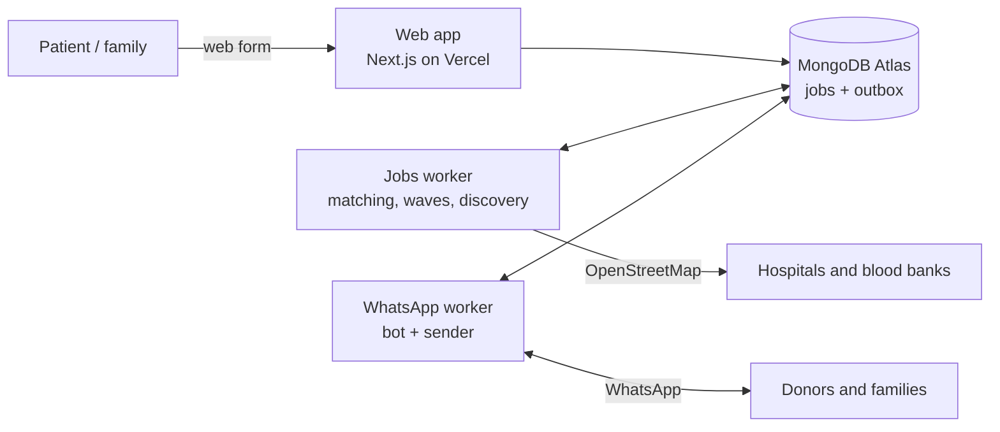

# MarutiX

**Every Drop Matters. Every Life Counts.**

[](https://github.com/Piyush-Sharma788/MauritX/actions/workflows/ci-cd.yml)
[](https://maurit-x.vercel.app)
[](LICENSE)

MarutiX is a blood emergency coordination platform. When a patient needs blood, it finds matching voluntary donors nearby, alerts them on WhatsApp in widening distance zones, and connects the family with donors who say yes. It also finds hospitals and blood banks near the patient.

**Live demo:** [maurit-x.vercel.app](https://maurit-x.vercel.app)
The website runs all the time. The WhatsApp bot and background workers run only during demos, so alerts and sign-in codes are sent only then.

> MarutiX coordinates communication and discovery. It does not collect, test, store, transport or certify blood, and it does not replace a licensed blood centre or a clinician.

## Features

- **Donor matching:** exact ABO/Rh blood group match, recorded consent, availability, a 90-day gap since the last donation, and distance. Every excluded donor is counted with a reason.
- **Zone-wise alerts:** donors are alerted in waves (0–5, 5–10, 10–25, 25–50 km), closest first, stopping once enough donors respond.
- **WhatsApp bot:** donor registration, emergency requests, request tracking and donor replies. It understands English, Hindi and Hinglish, including common typos.
- **AI layer (optional):** Gemini or OpenAI detects intent in free-text messages and extracts contacts from hospital websites. It always falls back to keyword matching, and AI results are stored as unverified.
- **Hospital and blood-bank discovery:** pulled from OpenStreetMap, enriched from the institution's own website (robots.txt respected), with email domains checked by DNS and duplicates merged while keeping every source.
- **Emergency requests without an account:** families create a request on the web or on WhatsApp and get a private tracking link.
- **Admin control centre:** requests, coordination, institutions, the WhatsApp session, operations and audit logs.
- **Security and privacy:** AES-256-GCM encryption for personal data, TOTP two-factor sign-in for staff, role-based access control (RBAC), CSRF checks, rate limits, consent records and audit logs. A donor's phone number is shared only after their explicit YES.

## Tech stack

| Area | Technologies |
|---|---|
| Frontend | Next.js 16 (App Router), React 19, TypeScript, Tailwind CSS 4, Leaflet |
| Backend | Next.js Route Handlers, Node.js workers, Zod validation |
| Database | MongoDB Atlas, Mongoose |
| Messaging | WhatsApp Cloud API, whatsapp-web.js, Nodemailer (SMTP) |
| AI | Gemini API, OpenAI API |
| Maps and data | OpenStreetMap (Overpass, Nominatim) |
| Testing | Vitest |
| DevOps | GitHub Actions, Docker, Vercel |

## Architecture

Three processes share one MongoDB database. MongoDB is also the message bus: background work is a `jobs` collection and every outgoing WhatsApp message is a row in a `notification_events` outbox, so no process calls another over HTTP.



- **Retries:** the outbox tries a message 3 times; jobs try 5 times and then move to a dead-letter list that an admin can retry.
- **Consent:** checked when a message is queued and again just before it is sent. STOP cancels messages already in the queue.
- **One WhatsApp session:** a MongoDB lease makes sure only one WhatsApp worker runs at a time.

## Getting started

Requirements: Node.js 24 and MongoDB (local, or a MongoDB Atlas URI).

```bash
npm install
npm run dev
```

On the first run, `npm run dev` creates `.env` with generated secrets. It then starts MongoDB if needed, the web app, the jobs worker and the WhatsApp worker, and lists any external credentials that are still missing (WhatsApp, AI provider, email).

| Command | What it does |
|---|---|
| `npm run dev` | Start everything locally |
| `npm run bot` | Start the WhatsApp and jobs workers against the live site |
| `npm test` | Unit tests |
| `npm run test:integration` | Unit and integration tests against a real MongoDB |
| `npm run test:e2e` | End-to-end run of the real web app and workers with simulated WhatsApp senders |
| `npm run lint`, `npm run typecheck` | ESLint and TypeScript checks |
| `npm run build` | Production build |

Every setting is documented in [.env.example](.env.example) and checked with Zod when each process starts. A process with a bad value refuses to run.

## Testing

- **657 unit and integration tests** (Vitest, real MongoDB, fake WhatsApp, email and OpenStreetMap providers). They cover matching, zone waves, consent, retries, STOP/START, discovery, security and the full request lifecycle.
- **End-to-end suite** that drives the real web app and workers with WhatsApp webhooks signed exactly as Meta signs them.
- **GitHub Actions** runs lint, type-checking and the tests on every pull request and push to `main`, then builds Docker images.

## Documentation

| Document | Covers |
|---|---|
| [SETUP.md](SETUP.md) | Running, deployment and production operations |
| [docs/DONOR_ALERTS_AND_BLOOD_CENTRE_NETWORK.md](docs/DONOR_ALERTS_AND_BLOOD_CENTRE_NETWORK.md) | Matching, alerts, discovery and outreach: how they work and how to test them |
| [docs/WHATSAPP_BOT_GUIDE.md](docs/WHATSAPP_BOT_GUIDE.md) | Connecting WhatsApp and the bot's conversations |
| [SYSTEM_DESIGN.md](SYSTEM_DESIGN.md), [DATABASE_SCHEMA.md](DATABASE_SCHEMA.md), [API_DOCUMENTATION.md](API_DOCUMENTATION.md) | Design, data model and API |
| [SECURITY_PRIVACY.md](SECURITY_PRIVACY.md) | Security and privacy model |
| [PRD.md](PRD.md) | Product requirements |

## Status and limitations

- **Pilot, not a production medical service.** It needs clinical, legal, privacy and operational review before real-world use.
- **No live blood stock data.** India's e-RaktKosh has no public API and is not scraped, so stock always shows as unknown and families are told to call.
- **Sparse hospital contact data.** OpenStreetMap has phone numbers or emails for only a small share of Indian hospitals, so admins add most contacts by hand.

## License

[MIT](LICENSE) © 2026 Piyush Sharma
