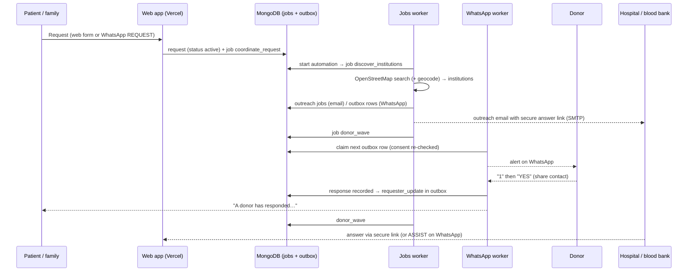

# Donor alerts and the blood-centre network: how it works, how to run it, how to test it

This guide covers the part of MarutiX that turns an emergency blood request into action:
donor matching, zone-by-zone WhatsApp alerts, donor replies, patient notifications, hospital and
blood-bank discovery, institutional outreach, and the safety rules around all of it.

It's written for a developer who has to configure, test, debug or change this system without
help. General project setup (Node, sign-in, deployment) is in [SETUP.md](../SETUP.md); the
WhatsApp conversation design is in [WHATSAPP_BOT.md](../WHATSAPP_BOT.md).

**Verified on 6 November 2026** against commit `4e7d65a` plus the fixes listed in
[§9](#9-verification-log-6-november-2026). Status labels below come from tests and checks that were
actually run, never from reading the code alone.

---

## Contents

1. [Status at a glance](#1-status-at-a-glance)
2. [Architecture](#2-architecture)
3. [Workflows: triggers, internals and what people experience](#3-workflows)
4. [Configuration reference](#4-configuration-reference)
5. [External services and how to set them up](#5-external-services)
6. [Running it](#6-running-it)
7. [Testing](#7-testing)
8. [Troubleshooting](#8-troubleshooting)
9. [Verification log (6 November 2026)](#9-verification-log-6-november-2026)
10. [Known gaps and recommendations](#10-known-gaps-and-recommendations)

---

## 1. Status at a glance

**Working**: behaves as specified in the evidence listed. **Partially working**: the logic works, but
something stops it working fully in practice (data, configuration or an unverified external step).
**Broken**: doesn't work, or does something it shouldn't.

Evidence levels, strongest first:

- **Live**: a real call to the real external service during this verification.
- **Real stack**: the real web app, jobs worker and WhatsApp worker processes (`npm run test:e2e`), with
  only inbound WhatsApp messages simulated (signed webhooks from synthetic numbers).
- **Mocked**: integration tests against a real MongoDB with fake WhatsApp, email and OpenStreetMap
  providers (`npm run test:integration`).

| Component | Status | Evidence | Notes |
|---|---|---|---|
| Location-based donor matching | **Working** | Mocked, Real stack | Exact ABO/Rh match, consent, availability, 90-day donation gap, straight-line distance. Every exclusion is counted. |
| Configurable distance zones (5/10/25/50 km) | **Working** | Mocked, Real stack | `DONOR_ZONES_KM`, default `5,10,25,50`, then a "same city, no location" stage. |
| Automated zone waves (closest first, stop at target) | **Working** | Mocked, Real stack | The jobs worker matched the donor and queued an alert within 90 s. |
| Alerts reach donors' phones | **Partially working** | Real stack (up to the outbox) | Queueing, consent and pacing work. Real delivery through WhatsApp Web wasn't tested with real phones, and **production currently has no WhatsApp worker running** ([§10](#10-known-gaps-and-recommendations)). |
| Donor replies: interested, unavailable, later, more info | **Working** | Mocked, Real stack | 1/2/3/4, words and Hinglish. A second "interested" isn't double-counted. Concurrent acceptances are each counted once. |
| Contact-sharing consent (separate YES) | **Working** | Mocked, Real stack | A donor's number is never shared without a second, explicit YES. |
| Patient told when a donor responds | **Working** (logic) | Mocked, Real stack | Once per response. Delivery has the same WhatsApp caveat as alerts. |
| Hospital and blood-bank discovery (OpenStreetMap) | **Working**, sparse data | **Live**, Mocked | Live: 85 places within 5 km of central Lucknow in 54 s. Only 2 had a phone and 1 an email; 0 were tagged as blood banks. |
| Geocoding (Nominatim) | **Working** | **Live**, Mocked | Live: "Hazratganj, Lucknow" resolved to 26.8475, 80.9432 in 450 ms through the app's own provider. |
| Website contact enrichment | **Working** | **Live** | Read robots.txt and pages of 1 site, found 1 phone and 1 email. |
| AI contact extraction / bot language understanding (Gemini) | **Working after fix** | **Live**, Real stack | It was **broken**: the default model `gemini-2.5-flash` returns 404 for this key, and every AI call silently fell back. The default is now `gemini-3.5-flash`. Live discovery after the fix: 0 AI failures, 1 contact extracted (before: 2 failures, 0 extracted). The bot's free-text intent passed in the real stack. |
| Bot first contact with AI on | **Partially working** | Real stack | A meaningless first message can get a short AI greeting instead of the numbered welcome menu, and in one run without the "call 112 / STOP" lines. See [§10](#10-known-gaps-and-recommendations). |
| Contact validation, duplicate detection, source tracking | **Working** | Mocked; Live (provenance) | Impossible email domains are never used; duplicates merge keeping every source; admin-owned values are never overwritten. |
| Institutional email outreach | **Partially working** | Mocked; **Live** (SMTP login only) | Gmail SMTP authenticated live; no real outreach email was sent. Sends only to admin-reviewed or verified addresses, and OSM rarely has any, so in practice an admin must add contacts first. |
| Institutional WhatsApp outreach + ASSIST/UNABLE | **Working** (logic) | Mocked | Only to *verified* institution contacts (none exist in production yet). |
| Institution response tracking (secure link, WhatsApp, admin) | **Working** | Mocked | "Can assist" is always shown as "may be able to assist (stock not confirmed)". |
| Retries, dead-lettering | **Working** | Mocked, Real stack | Outbox: 3 attempts (30 s, 2 min). Jobs: 5 attempts (1, 5, 15, 60 min), then dead-letter with an admin Retry. |
| Delivery status (sent → delivered → read) | **Working** | Real stack | Status only moves forward; a late "delivered" never downgrades "read". |
| Consent checks and STOP / START | **Working** | Mocked, Real stack | Checked when queued and again just before sending. STOP suppresses already-queued messages. |
| Per-donor caps, pacing, alerts-paused switch | **Working** | Mocked | `ALERT_MAX_PER_DONOR_PER_DAY` (2), hourly caps, a global pause. |
| Closing a request stops everything | **Working** | Mocked | Fulfilled, cancelled or expired: waves and outreach stop, queued alerts are withdrawn. |
| WhatsApp Cloud API path (official) | **Working** (failure path) | **Live** | A real call to `graph.facebook.com` with a deliberately invalid token was refused (401/190) and failed permanently: no retries, no fake success. The success path needs real Meta credentials. |
| Blood stock availability | **Not available by design** | Mocked | There is no public live stock source (e-RaktKosh has no public API). Stock is always "unknown". Discovery or contact never implies stock. |
| Request verification before alerts | **Broken (accuracy)** | Mocked, Real stack | Requests now go live and alert donors on creation, without a human check, yet the tracking page and the bot say "Verified by MarutiX". See [§10](#10-known-gaps-and-recommendations). |
| Donor sign-up link on the website | **Broken (configuration)** | Read-only check | `WHATSAPP_WEB_PUBLIC_NUMBER` isn't set, so `/donate` says registration isn't open. |

---

## 2. Architecture

Three processes share one MongoDB database. MongoDB is also the message bus: background work is a
`jobs` collection, and every outgoing WhatsApp message is a row in the `notification_events` outbox.
No process calls another over HTTP for this pipeline.

| Process | Command | Hosted (today) | Does |
|---|---|---|---|
| Web app | `npm start` / Vercel | Vercel | Pages, API, request intake, admin, tracking links, WhatsApp Cloud webhook. Queues jobs and messages; never sends WhatsApp itself. |
| Jobs worker | `npm run jobs:worker:prod` | A laptop (see [§10](#10-known-gaps-and-recommendations)) | Coordination, discovery, outreach email, donor waves, retention. With `MESSAGING_PROVIDER=whatsapp_cloud`, it also drains the outbox. Safe to run more than one. |
| WhatsApp worker | `npm run whatsapp:worker:prod` | A laptop | Owns the whatsapp-web.js session (exactly one, enforced by a MongoDB lease). Drains the outbox, reads inbound messages, runs the bot. |



Code map:

| Area | Files |
|---|---|
| Request intake and lifecycle | `src/server/requests/service.ts`, `status.ts`, `whatsapp.ts` |
| Automation (start, waves, pause/resume) | `src/server/coordination/automation.ts`, `zones.ts`, `alerts.ts` |
| Matching | `src/server/matching/engine.ts` (pure), `service.ts` |
| Outbox, eligibility, dispatcher, pacing | `src/server/messaging/queue.ts`, `eligibility.ts`, `dispatcher.ts`, `pacing.ts` |
| Inbound bot and donor replies | `src/server/conversations/*`, `src/server/messaging/inbound.ts` |
| Patient notifications | `src/server/coordination/requester.ts` |
| Discovery | `src/server/discovery/*` (`nearby.ts`, `records.ts`, `areas.ts`, `ai-extract.ts`, `availability.ts`) |
| Outreach | `src/server/outreach/service.ts`, `templates.ts`; institution WhatsApp commands in `src/server/institutions/whatsapp.ts` |
| Jobs | `src/server/jobs/queue.ts`, `runner.ts`; loop in `src/worker/jobs/main.ts` |
| WhatsApp worker | `src/worker/whatsapp/*` |

---

## 3. Workflows

### 3.1 A request is created

**Trigger:** the web form at `/request`, or `REQUEST` (or free text such as "need O+ blood urgently") on WhatsApp.

1. The request is validated, encrypted (patient and contact details) and saved with status
   **`active`**. Duplicate submissions are blocked, and a phone number can create at most 3 recent requests.
2. `onRequestActivated` queues one `coordinate_request` job (idempotent per request), unless
   `COORDINATION_AUTOSTART=false`.
3. The requester gets a private manage link. WhatsApp requesters also get the request ID and link in the chat.

> **Changed recently:** requests used to start as `pending_verification` and wait for an admin
> to verify and activate them. They now go live immediately. See [§10](#10-known-gaps-and-recommendations).

**What people see:** the family sees the tracking page, with the 5-step "Donor matching progress"
tracker and the status history. Admins see the request on `/admin/requests` with an *Urgent* marker.

### 3.2 Coordination starts

**Trigger:** the jobs worker picks up `coordinate_request`.

`startCoordination` sets `automation.status = running`, records a requester-visible event
("MarutiX started contacting nearby hospitals, blood banks and registered donors."), and queues
`discover_institutions`. Discovery runs first because it may geocode the hospital address, which
the donor waves need as their centre.

**Search centre**, in order:

1. the linked institution's location, then
2. the requester's shared device location (approximate, about 100 m), then
3. the geocoded hospital address.

With none of these, matching falls back to the same city, and zones don't apply.

### 3.3 Hospital and blood-bank discovery

**Trigger:** `discover_institutions` (per request), plus a background `discovery_sweep` every
`DISCOVERY_SWEEP_INTERVAL_MINUTES` (60) that refreshes areas around donors and requests.

1. **Existing institutions** in MarutiX within `OUTREACH_RADIUS_KM` (25 km) are used first.
2. If `DISCOVERY_PROVIDER=openstreetmap`, **Overpass** is searched for hospitals and blood banks
   around the centre. **Nominatim** geocodes city-only places. Both need an identifying contact
   (`DISCOVERY_CONTACT_EMAIL` or `DISCOVERY_CONTACT_URL`), or they refuse requests.
3. **Records** are normalised and **deduplicated**: an existing record is updated, and duplicates
   are merged, keeping every source reference. Admin-owned or verified values are never overwritten.
   Each field keeps its **source** (`fieldSources`, `sourceRecords`, `externalRefs`, `lastSeenAt`).
4. **Website enrichment** (up to `DISCOVERY_ENRICH_PER_RUN`): it reads robots.txt and up to 2 pages
   of the institution's own site, with SSRF guards. It extracts phones and emails, optionally with AI
   (`DISCOVERY_AI_EXTRACTION`), and only keeps AI results above `DISCOVERY_AI_MIN_CONFIDENCE`.
5. **Contact validation:** emails whose domain can't receive mail (DNS/MX) are marked invalid and
   are never used. Website reachability is checked when `DISCOVERY_VALIDATE_WEBSITES` is on.
6. **Ranking:** verified institutions first, then blood banks, then by distance. The top
   `OUTREACH_MAX_INSTITUTIONS` (10) go to outreach.
7. **Staleness:** places a source no longer publishes are marked stale, never deleted. Stale,
   rejected, suspended, excluded and merged records are left out of results.

**Status of every discovered record: unverified.** Nothing becomes verified without an admin.

**What admins see:** `/admin/institutions` with a map. Discovered records are marked
"needs review"; admins approve, exclude, add official contacts and verify.
**What the family sees:** "Nearby blood banks & hospitals" with a map. Verified places come first;
unverified ones are labelled as public listings to confirm by phone. **Stock is never claimed.**

### 3.4 Institutional outreach

**Trigger:** `institution_outreach` after discovery, then `send_outreach_email` per delivery.

- **Email** goes only to addresses an admin approved or verified (`OUTREACH_INCLUDE_UNREVIEWED=false`
  by default), with `EMAIL_PROVIDER=smtp`. Each email contains a **secure answer link**
  (`/respond/<token>`, no login) and an unsubscribe link. It's capped by
  `OUTREACH_MAX_PER_INSTITUTION_PER_DAY` and `EMAIL_MAX_PER_HOUR`.
- **WhatsApp** goes only to **verified institution contacts**. They can reply `ASSIST MX-…` or
  `UNABLE MX-…`, and coordinators can also send `ACK`, `REQUESTS`, `AVAILABLE`, `PARTIAL` or
  `FULFILLED`.
- **Outreach statuses:** `awaiting_review` (contacts need admin review), `no_contact`,
  `channel_unavailable` (for example, email not configured), `queued`, `sent`, `partially_sent`,
  `failed`, `excluded`, `cancelled`.
- **Answers** (`can_assist`, `cannot_assist`, `need_info`) come from the secure link, WhatsApp, or
  an admin recording a phone call. The source is stored with each answer.
- **Nothing is claimed as sent** unless the provider accepted it. A missing email provider shows
  "Email not configured".

### 3.5 Donor matching and zone waves

**Trigger:** `donor_wave` jobs. Wave 1 is queued right after discovery. Each later wave is
queued `DONOR_WAVE_INTERVAL_MINUTES` (20) after the previous one, or immediately when an admin
presses "send the next wave now".

**Matching** (`src/server/matching/engine.ts`, pure and deterministic). A donor is a candidate only
if every check passes. Otherwise exactly one exclusion reason is counted:

| Check | Exclusion reason |
|---|---|
| Not the requester themself | `requester_self` |
| Account active | `account_inactive` |
| Not opted out (STOP) | `opted_out` |
| Recorded WhatsApp alert consent, not withdrawn | `no_alert_consent` |
| Alerts not paused by the donor | `alerts_paused` |
| Marked available | `not_available` |
| Blood group known | `donor_blood_group_unknown` |
| Exact ABO and Rh match (pending clinical review) | `blood_group_not_matched` |
| Last donation ≥ `MATCH_MIN_DONATION_INTERVAL_DAYS` (90) ago | `recent_donation` |
| Within the radius (both locations known), or the same city (no location) | `outside_radius`, `different_city` |
| Not already alerted about, or answered, this request | `already_contacted` |
| Within `MATCH_MAX_CANDIDATES` | `over_candidate_limit` |

Candidates are ranked by straight-line distance (never route or travel time), and each carries a
human-readable reason ("About 3.2 km away in a straight line").

**Waves** (`src/server/coordination/zones.ts`):

- Zones are `DONOR_ZONES_KM` (default `5,10,25,50`), that is 0–5, 5–10, 10–25 and 25–50 km, then a
  final stage for same-city donors with no shared location.
- Each wave alerts up to `DONOR_WAVE_SIZE` (5) donors from the current zone, closest first. A zone
  is finished before the next opens, and a donor who becomes eligible in an earlier zone is never skipped.
- Expansion **stops** when enough donors are interested: `DONOR_TARGET_INTERESTED`, or by default
  2 × units with a minimum of 2. It also stops when every zone is exhausted, at
  `ALERT_MAX_PER_REQUEST` (40), or when the request closes or expires.
- Waves are **deferred** (not lost) while an admin has paused all alerts.
- Each alert expires after `ALERT_TTL_MINUTES` (60) if it couldn't be sent. After a WhatsApp outage,
  the next wave re-arms expired alerts instead of skipping those donors.

**The alert** (no patient name, ever):

```
MARUTIX — URGENT BLOOD REQUEST
Blood group: B+ · Component: Whole blood · Units required: 1
Hospital: … · Location: <locality>, <city> · Distance: approximately 4 km (straight line)
Required by: … · Ref: MX-XXXXXXXX
Reply: 1 — I am interested · 2 — Not available · 3 — Contact me later · 4 — More information
Reply STOP to stop all alerts.
Final donor eligibility and compatibility will be assessed by the blood centre.
```

### 3.6 Donor replies

**Trigger:** an inbound WhatsApp message from an alerted donor.

| Donor sends | Result |
|---|---|
| `4` / "more info" | Hospital details. No commitment. |
| `1` / "interested" | Asked separately whether their **contact may be shared** with the family. |
| `YES` (after 1) | Interest recorded **with** sharing consent, plus next steps. |
| `NO` (after 1) | Interest recorded **without** sharing; the MarutiX team coordinates. |
| `2` / "not available" | Recorded; replaces any earlier interest. |
| `3` / "later" | Recorded as "contact me later". |
| `STOP` | Opt-out: consent withdrawn and queued messages suppressed. One confirmation is sent, then silence until `START`. |

**Duplicate prevention:**

- A redelivered message ID gets no second reply.
- A second "interested" isn't counted twice.
- Concurrent acceptances from different donors are each counted exactly once.
- Simultaneous messages from one number are processed in order.

Interest is **not** a donation. Admins move a donor through `coordinator_contacted`, then
`hospital_coordination`, then `donor_arrived`, then `donation_confirmed`, as it actually happens.
Only `donation_confirmed` counts as a donation.

### 3.7 Patient notification when a donor responds

**Trigger:** the first recorded response from a donor (`notifyRequesterOfDonor`, guarded by
`requesterNotifiedAt` so it runs once per response).

- **Requests made on WhatsApp** (the number is verified by WhatsApp itself): if the donor agreed to
  share, the family gets the donor's first name, self-reported blood group, area and phone number.
  Otherwise they get a note that the team will coordinate.
- **Web requests** (the phone number is unverified): only a nudge to open the private tracking link
  (if WhatsApp updates were requested). Donor numbers are never sent to an unverified number.
  On the manage link, revealing a consenting donor's number is logged every time.
- Every message also says that interest isn't a confirmed donation, and that the blood centre decides.

### 3.8 Closing

**Triggers:** the requester ("We got the blood" / "Some units arranged" / "Cancel"), an admin, an
institution coordinator (`FULFILLED` / `PARTIAL`), or expiry (24 h after the required-by time, at
most 14 days after creation).

`onRequestClosed` stops automation, cancels pending wave, outreach and discovery jobs, cancels open
outreach, and withdraws queued alerts. Donors get no more alerts for that request.

### 3.9 Safety rules that apply to every message

- **Consent:** checked when a message is queued **and** again just before it's sent
  (`checkEligibility`).
- **STOP:** honoured even with the bot switched off. A STOP confirmation is the only message allowed afterwards.
- **Caps and pacing:**
  - at most `ALERT_MAX_PER_DONOR_PER_DAY` (2) alerts per donor;
  - `WHATSAPP_WEB_MAX_MESSAGES_PER_HOUR` (proactive) and `WHATSAPP_WEB_MAX_REPLIES_PER_HOUR` (conversational);
  - `WHATSAPP_WEB_MIN_SEND_INTERVAL_MS` between sends.
- **Retries:**
  - outbox sends: 3 attempts (after 30 s, then 2 min), only for retryable errors. "Not on WhatsApp"
    and Cloud API auth errors fail at once.
  - jobs: 5 attempts (1, 5, 15, 60 min), then `dead`, with a Retry button on `/admin/operations`.
- **Crash safety:** a message left mid-send by a crashed worker is marked failed, never resent
  blindly. Only one WhatsApp worker can hold the session (MongoDB lease).
- **Delivery status:** WhatsApp acknowledgements move `sent → delivered → read` forward only.
- **Privacy:** message bodies are encrypted in the outbox and erased once final. Phone numbers are
  stored encrypted, plus a keyed lookup hash. Donors never appear on any map; the public tracking
  map shows only facilities, plus a search area if it's the hospital's own location.

---

## 4. Configuration reference

All settings are environment variables. Locally they live in `.env` (git-ignored; see
`.env.example`). In production they belong in the hosting provider (Vercel for the web app) and in
each worker's environment. **Workers need the same core secrets as the web app**
(`MONGODB_URI`, `AUTH_JWT_SECRET`, `OTP_HASH_SECRET`, `PII_ENCRYPTION_KEY`): they decrypt phone
numbers the web app encrypted.

Where each setting is needed: **W** = web app, **J** = jobs worker, **WA** = WhatsApp worker.

### Core

| Variable | Default | Where | Purpose |
|---|---|---|---|
| `MONGODB_URI` | — (required) | W J WA | Shared database (MongoDB Atlas in production). |
| `APP_BASE_URL` | — (required) | W J WA | Public site URL, used in tracking, respond and alert links. **Must be the real https URL in worker environments too.** |
| `PII_ENCRYPTION_KEY`, `AUTH_JWT_SECRET`, `OTP_HASH_SECRET` | — (required) | W J WA | Must be identical everywhere. |

### Matching, waves and alerts

| Variable | Default | Purpose |
|---|---|---|
| `COORDINATION_AUTOSTART` | `true` | Start automation when a request goes live. `false` means admins use manual batches. |
| `DONOR_ZONES_KM` | `5,10,25,50` | 1–6 increasing distances (km, ≤ 100). |
| `DONOR_WAVE_SIZE` | `5` | Donors per wave. |
| `DONOR_WAVE_INTERVAL_MINUTES` | `20` | Gap between waves. |
| `DONOR_TARGET_INTERESTED` | `0` | Interested donors that stop expansion (`0` = 2 × units, minimum 2). |
| `ALERT_BATCH_SIZE` | `5` | Size of a manual "send the next N" batch. |
| `ALERT_MAX_PER_REQUEST` | `40` | Hard cap on alerts per request. |
| `ALERT_MAX_PER_DONOR_PER_DAY` | `2` | Per-donor daily cap (1–5). |
| `ALERT_TTL_MINUTES` | `60` | An unsent alert expires after this. |
| `MATCH_MIN_DONATION_INTERVAL_DAYS` | `90` | Minimum gap since the last donation. |
| `MATCH_MAX_CANDIDATES` | `100` | Candidates considered per search. |

### Discovery (OpenStreetMap)

| Variable | Default | Purpose |
|---|---|---|
| `DISCOVERY_PROVIDER` | `none` | `openstreetmap` turns on Overpass and Nominatim. |
| `DISCOVERY_CONTACT_EMAIL` / `DISCOVERY_CONTACT_URL` | — | **Required** with `openstreetmap`. Sent in the User-Agent; Nominatim rejects fake contacts with 403. |
| `OVERPASS_URL` | `https://overpass-api.de/api/interpreter` | Run your own for production volume. |
| `NOMINATIM_URL` | `https://nominatim.openstreetmap.org` | Same. |
| `DISCOVERY_TIMEOUT_MS` | `60000` | Overpass is slow (30–55 s observed). |
| `DISCOVERY_AREA_RADIUS_KM` | `10` | Background area refresh radius. |
| `DISCOVERY_SWEEP_INTERVAL_MINUTES` | `60` | Background sweep cadence. |
| `DISCOVERY_REFRESH_DAYS` | `14` | Re-check an area after this. |
| `DISCOVERY_REQUEST_DELAY_MS` | `30000` | Politeness gap between OSM calls. |
| `DISCOVERY_BACKOFF_MINUTES` | `60` | Wait after a 429/504. |
| `DISCOVERY_WEBSITE_ENRICHMENT` | `true` | Read institutions' own websites for contacts. |
| `DISCOVERY_ENRICH_PER_RUN` | `6` | Websites read per run. |
| `DISCOVERY_AI_EXTRACTION` | `true` | Use the AI provider to extract contacts from website text. |
| `DISCOVERY_AI_MIN_CONFIDENCE` | `0.6` | Discard AI contacts below this. |
| `DISCOVERY_VALIDATE_CONTACTS` / `DISCOVERY_VALIDATE_WEBSITES` | `true` | DNS/MX check of emails; website reachability. |
| `BLOOD_AVAILABILITY_PROVIDER` | `none` | Only `none` exists: stock is always "unknown". |

### Outreach and email

| Variable | Default | Purpose |
|---|---|---|
| `OUTREACH_RADIUS_KM` | `25` | Institutions considered. |
| `OUTREACH_MAX_INSTITUTIONS` | `10` | Institutions contacted per request. |
| `OUTREACH_INCLUDE_UNREVIEWED` | `false` | Keep it `false`: unreviewed OSM contacts aren't used. |
| `OUTREACH_MAX_PER_INSTITUTION_PER_DAY` | `5` | Per-institution daily cap. |
| `COORDINATOR_CONTACT_PHONE` / `COORDINATOR_CONTACT_EMAIL` | — | Shown in outreach as the responsible coordinator. |
| `EMAIL_PROVIDER` | `none` | `smtp` turns on email. |
| `SMTP_HOST`, `SMTP_PORT` (587), `SMTP_SECURE` (`false`), `SMTP_USER`, `SMTP_PASSWORD`, `EMAIL_FROM`, `EMAIL_REPLY_TO` | — | Gmail: `smtp.gmail.com`, port 587, `SMTP_SECURE=false` (STARTTLS), plus an **app password**. |
| `EMAIL_MAX_PER_HOUR` | `60` | Global email cap. |

### WhatsApp

| Variable | Default | Purpose |
|---|---|---|
| `MESSAGING_PROVIDER` | `whatsapp_web` | `whatsapp_web` (pilot, whatsapp-web.js) or `whatsapp_cloud` (official Cloud API). |
| `WHATSAPP_WEB_PUBLIC_NUMBER` | — | The number donors message to register. **If empty, the website says registration isn't open.** Set it on Vercel too. |
| `WHATSAPP_WEB_SESSION_DIR` | `~/.marutix/whatsapp-session` | Paired session. Keep it outside the project folder. |
| `WHATSAPP_WEB_WORKER_SECRET` | — | Control-channel secret (admin QR/connect pages, same machine only). |
| `WHATSAPP_WEB_MAX_MESSAGES_PER_HOUR` | `30` | Proactive messages (alerts) per hour. |
| `WHATSAPP_WEB_MAX_REPLIES_PER_HOUR` | `300` | Conversational replies per hour. |
| `WHATSAPP_WEB_MIN_SEND_INTERVAL_MS` | `4000` | Gap between sends. |
| `WHATSAPP_WEB_MESSAGE_TTL_MINUTES` | `15` | Default expiry for queued non-alert messages. |
| `WHATSAPP_WEB_TEST_RECIPIENTS` | — | Numbers that may receive admin test messages. |
| `WHATSAPP_ACCESS_TOKEN`, `WHATSAPP_PHONE_NUMBER_ID`, `WHATSAPP_APP_SECRET`, `WHATSAPP_WEBHOOK_VERIFY_TOKEN`, template names | — | Cloud API only (see SETUP.md, "Switching to the official WhatsApp Cloud API"). |

### AI (optional)

| Variable | Default | Purpose |
|---|---|---|
| `AI_PROVIDER` | `none` | `gemini`, `openai` or `anthropic`. Used for bot language understanding (in the WhatsApp worker) and website contact extraction (in the jobs worker). |
| `AI_MODEL` | provider default | Gemini default is now `gemini-3.5-flash`. **Model names get retired**: if you see `discovery.ai_extract_failed` or the bot ignoring free text, check the model ([§8](#8-troubleshooting)). |
| `GEMINI_API_KEY` / `OPENAI_API_KEY` / `ANTHROPIC_API_KEY` | — | Key for the chosen provider. |

AI only proposes. The bot validates every value with the same parsers as typed answers, consent is
never taken from AI, and an AI-written clarifying reply is sent only if it's at most 300 characters
and claims nothing (no "registered/confirmed/verified/eligible/compatible…", no links, no long
numbers).

### Not used

`MAPS_API_KEY` and `REDIS_URL` are reserved. Maps use OpenStreetMap tiles (no key); the content
security policy allows `https://tile.openstreetmap.org` for images.

---

## 5. External services

| Service | Used for | Key needed | Setup |
|---|---|---|---|
| MongoDB Atlas | Everything | Connection string | Create a cluster and a database user, then allow the hosts. Same `MONGODB_URI` for web and workers. |
| WhatsApp (pilot) | Alerts, bot, sign-in codes | A spare WhatsApp account | Run the WhatsApp worker and scan the QR code once (terminal, or `/admin/whatsapp`). |
| WhatsApp Cloud API (official) | The same, at scale | Meta app, number, templates | SETUP.md, "Switching to the official WhatsApp Cloud API". Proactive alerts outside 24 h need approved templates. |
| SMTP (Gmail) | Outreach email | App password | Google Account → Security → 2-Step Verification → App passwords. Use the 16-character password as `SMTP_PASSWORD`. |
| OpenStreetMap Overpass + Nominatim | Discovery, geocoding | None, but **contact required** | Set `DISCOVERY_CONTACT_EMAIL`. Respect the usage policies; self-host for volume. |
| OpenStreetMap tiles | Maps | None | Fine for a pilot. For heavy traffic, use a tile provider (and update the CSP). |
| Gemini / OpenAI / Anthropic | Optional AI | API key | Set `AI_PROVIDER`, the key, and (recommended) `AI_MODEL`. |
| e-RaktKosh | — | — | No public API. MarutiX links to it but never imports stock. |

---

## 6. Running it

### Locally (all processes)

```bash
cp .env.example .env        # then fill in the values you need
npm install
npm run dev                 # web + jobs worker + WhatsApp worker (+ local MongoDB if MONGODB_URI is local)
```

`npm run dev` prints a QR code for the WhatsApp worker. Scan it with a **spare** test account.
To try discovery locally, set `DISCOVERY_PROVIDER=openstreetmap` and `DISCOVERY_CONTACT_EMAIL=<you>`.

### Production

| Process | Run with |
|---|---|
| Web | Vercel (deploys from `main`). Set every core variable plus `WHATSAPP_WEB_PUBLIC_NUMBER`. |
| Jobs worker | `npm run jobs:worker:prod` with the production environment (or `deploy/oracle/docker-compose.yml`, service `jobs`). |
| WhatsApp worker | `npm run whatsapp:worker:prod` (or the compose service `worker`). Exactly one. |

Always-on hosting for both workers: [deploy/oracle/README.md](../deploy/oracle/README.md).

A worker running on a laptop stops when the laptop sleeps. While the **jobs worker** is down,
requests wait and no waves run. While the **WhatsApp worker** is down, alerts, sign-in codes and
bot replies wait in the outbox and expire after their TTL.

### Admin access

```bash
npm run admin:grant -- super_admin +91XXXXXXXXXX   # then sign in; 2FA enrolment is required
npm run admin:list
```

---

## 7. Testing

### 7.1 Mocked tests (no external services, no real messages)

```bash
npm test                                   # unit tests; integration tests are skipped
# Integration tests need a throwaway MongoDB:
MONGODB_URI_TEST=mongodb://127.0.0.1:27017/marutix_test npm test
```

`tests/setup.ts` replaces `MONGODB_URI` with `MONGODB_URI_TEST` and uses throwaway secrets, so
tests can't reach production.

| Suite | Covers |
|---|---|
| `tests/phase6-workflows.integration.test.ts` | Request → discovery → outreach → zone waves → acceptance → patient connection → sharing → admin control; STOP; expiry; outage handling; concurrency; dead jobs. |
| `tests/phase5-workflows.integration.test.ts` | Patient flow on WhatsApp, donor registration and replies, matching rules, institution commands, reliability (restarts, duplicates, retries, caps, pause). |
| `tests/messaging.integration.test.ts` | Outbox rules, consent re-check, retries, expiry, crash safety, hourly cap, forward-only status, STOP, worker lease. |
| `tests/discovery-workflows.integration.test.ts` | Areas, refresh and staleness, merging with provenance, contact validation, 429/504 backoff, nearby facilities (stock unknown). |
| `tests/requests.integration.test.ts` | Intake, encryption, duplicates, rate limits, tracking privacy, lifecycle, expiry. |
| `tests/phase5-units.test.ts`, `tests/phase6-units.test.ts` | Matching engine, zones, OSM normalisation, robots.txt, SSRF guards, outreach planning. |

### 7.2 Real stack (real processes, simulated inbound WhatsApp)

```bash
# IMPORTANT: point it at a local MongoDB. It derives its throwaway database from MONGODB_URI,
# and .env usually holds the production cluster.
MONGODB_URI=mongodb://127.0.0.1:27017/marutix npm run test:e2e
```

It starts the real web app, jobs worker and WhatsApp worker (unpaired session) on separate ports
against `marutix_e2e_<random>` (dropped afterwards), sends signed webhooks from synthetic numbers,
and in phase 2 calls Meta's real Graph API with a deliberately invalid token. **No real person can
be messaged.** Stop `npm run dev` first.

### 7.3 Live checks against real services (no messages to people)

```bash
# OpenStreetMap discovery into a throwaway "…check…" database (about 4 polite external requests):
DISCOVERY_CHECK_MONGODB_URI=mongodb://127.0.0.1:27017/marutix_discovery_check \
  npx tsx --conditions=react-server --env-file=.env scripts/discovery-check.ts 26.8467 80.9462 5

# SMTP login only (sends nothing):
node --env-file=.env -e 'const n=require("nodemailer");n.createTransport({host:process.env.SMTP_HOST,port:+process.env.SMTP_PORT||587,secure:process.env.SMTP_SECURE==="true",auth:{user:process.env.SMTP_USER,pass:process.env.SMTP_PASSWORD}}).verify().then(()=>console.log("SMTP OK"),e=>console.log("SMTP FAILED",e.message))'

# AI model availability (one tiny request):
node --env-file=.env -e 'fetch(`https://generativelanguage.googleapis.com/v1beta/models/${process.env.AI_MODEL||"gemini-3.5-flash"}:generateContent`,{method:"POST",headers:{"content-type":"application/json","x-goog-api-key":process.env.GEMINI_API_KEY},body:JSON.stringify({contents:[{parts:[{text:"Reply OK"}]}]})}).then(async r=>console.log(r.status,(await r.json()).error?.message??"OK"))'
```

### 7.4 Manual end-to-end with real phones (do this before relying on alerts)

Use only phones you own and a spare WhatsApp account for MarutiX. Never use real patient data.

1. Run the WhatsApp worker and pair the spare account. `/admin/operations` should show
   **Connected**, with a fresh heartbeat.
2. From **phone B** (the donor), send `REGISTER` to the MarutiX number and finish registration with
   your real blood group, a nearby location and alerts on.
3. From **phone A** (the family), send `REQUEST` and describe a test need in the same city with
   the same blood group. Mark it clearly as a test (for example, patient name "TEST").
4. Within about a minute the jobs worker runs wave 1: phone B receives "URGENT BLOOD REQUEST".
   Check `/admin/requests/<id>`: the progress shows "Donors alerted".
5. From phone B, reply `1`, then `YES`. Phone A should receive "A donor has responded…" with
   phone B's first name and number.
6. Reply `STOP` from phone B. Check that it gets one confirmation and no further alerts.
7. Close the request ("We got the blood" on the tracking link). Check that no further waves run.
8. Email: approve an institution whose contact is **your own** test mailbox, create a request near
   it, and confirm the outreach email and its secure answer link work.

---

## 8. Troubleshooting

| Symptom | Likely cause | Fix |
|---|---|---|
| Requests stay at "Donors alerted: searching"; `/admin/operations` shows queued jobs | Jobs worker not running | Start `npm run jobs:worker:prod`; check its log for `jobs.worker.started`. |
| Alerts queued but never sent; WhatsApp shows "Worker offline" | WhatsApp worker down, or the session expired | Start the worker; re-scan the QR code if the state is `qr_required`. |
| Two workers fighting, "lease held" | A second WhatsApp worker | Stop one. Only one may hold the session. |
| Alerts expire unsent after an outage | TTL passed while the worker was down | Expected. The next wave re-arms them. Raise `ALERT_TTL_MINUTES` for longer outages. |
| No donors matched | Blood group "not sure", no consent, recent donation, or no location and a different city | Read the exclusion counts on the request page. |
| Discovery finds nothing, or is slow | Overpass slow or refusing (429/504), or no contact configured | Wait for backoff; set `DISCOVERY_CONTACT_EMAIL`; consider your own Overpass. |
| Nominatim 403 | Fake or missing contact | Set a real `DISCOVERY_CONTACT_EMAIL`. |
| Outreach "awaiting review" or "no contact" | Discovered contacts unreviewed or missing (common with OSM) | Review on `/admin/institutions?review=unreviewed` and add official contacts. |
| Outreach "Email not configured" | `EMAIL_PROVIDER` isn't `smtp` in the **jobs worker's** environment | Set the SMTP variables where the jobs worker runs. |
| Gmail `535 Username and Password not accepted` | Normal password used, or 2-Step Verification off | Use an app password. |
| `discovery.ai_extract_failed` in logs; the bot ignores free text | AI model retired (404) or overloaded (503) | Check the model with the command in [§7.3](#73-live-checks-against-real-services-no-messages-to-people); set `AI_MODEL` to an available model. |
| Donor links in alerts point to localhost | Worker started with a local `APP_BASE_URL` | Set `APP_BASE_URL=https://<your site>` in the worker environment. |
| "Become a Donor" says registration isn't open | `WHATSAPP_WEB_PUBLIC_NUMBER` empty | Set it (on Vercel too) and redeploy. |
| Map shows "The map couldn't load" | Tiles blocked by CSP, or offline | Check that `img-src` includes `https://tile.openstreetmap.org` (`next.config.ts`). |

---

## 9. Verification log (6 November 2026)

| Check | Result |
|---|---|
| Unit + integration tests against MongoDB (`MONGODB_URI_TEST` set) | **Initially 19 of 657 failed.** All failures were outdated expectations from before requests went live on creation (they expected `pending_verification` and an admin verify/activate step). Test setup and expectations were updated without removing any workflow assertion. **Now 657/657 pass, none skipped.** |
| Real-stack end-to-end (`npm run test:e2e`, local MongoDB) | First run 67/74. After updating 5 outdated "pending verification" checks: **70/73**. The 3 remaining failures are all the AI-dependent welcome-menu behaviour described below. Every alert, reply, consent, STOP, receipt and Cloud API check passed. |
| Live OpenStreetMap discovery, 5 km around central Lucknow | 85 institutions in 54 s. Phones 2/85, emails 1/85, websites 5/85, opening hours 0/85. Capability: 0 blood banks, 1 hospital with a blood bank (name-inferred), 84 hospitals. All unverified. |
| Live website enrichment | 1 site read (robots.txt respected); 1 phone and 1 email extracted. |
| Live Gemini | `gemini-2.5-flash` → **404 "no longer available to new users"**. `gemini-3.5-flash` → HTTP 200. `gemini-3.8-flash`, `gemini-3.7-flash` and `gemini-flash-latest` returned 503 (overloaded) at the time. The code default was changed to `gemini-3.5-flash`; live discovery then extracted 1 contact with AI and had 0 failures. |
| Live Nominatim geocoding | "Hazratganj, Lucknow" → 26.8475, 80.9432 (450 ms), through `OpenStreetMapProvider.geocode`. |
| Live SMTP (Gmail) | Connected, STARTTLS, authenticated. **No email sent.** |
| Live WhatsApp Cloud API | Invalid-token call refused (401/190) and failed permanently, as designed. |
| Live map tiles | OSM tiles load on the tracking and admin maps (checked in a browser). |
| Production state (read-only) | WhatsApp **disconnected, no worker running**. Jobs worker running (discovery sweeps). 0 requests, 0 donors, 0 institutions, 0 outbox messages. |

**AI and the welcome menu:** with `AI_PROVIDER` set, a meaningless first message ("asdfgh qwerty",
"zzzz") can get a short, filtered AI greeting instead of the numbered welcome menu, so the menu
appears a message or two later. In one run the AI greeting left out the "call 112" and "STOP" lines
that the fixed welcome always carries. With `AI_PROVIDER=none` the menu is always shown. The three
related e2e checks expect the menu.

**Not verified with real people:** WhatsApp delivery of alerts and patient notifications to real
phones (whatsapp-web.js), and real delivery of outreach email. Use [§7.4](#74-manual-end-to-end-with-real-phones-do-this-before-relying-on-alerts) before relying on either.

---

## 10. Known gaps and recommendations

In priority order:

1. **Requests skip human verification but say they were verified (accuracy and safety).** Requests
   are created `active` with `verifiedAt` set, so donors are alerted immediately, yet the tracking page
   ("Confirmed during MarutiX verification") and the bot ("Verified by MarutiX: Yes") claim a check
   that didn't happen. The home page still says "We verify it with the hospital… Nothing is verified
   automatically." Choose one:
   - **(a)** restore admin verification before alerts (the code still supports
     `pending_verification → verified → active`); or
   - **(b)** keep auto-activation, but stop setting `verifiedAt` at creation and change the wording to
     "Not yet verified by MarutiX".
2. **Production can't deliver WhatsApp right now.** The WhatsApp worker isn't running (state
   `disconnected`), and the jobs worker runs on a laptop. Move both to always-on hosting
   (`deploy/oracle/`), then pair the number.
3. **Donors can't find the registration number.** Set `WHATSAPP_WEB_PUBLIC_NUMBER` on Vercel
   and in `.env`, then redeploy.
4. **Outreach depends on admin data entry.** OSM rarely lists contacts for Indian hospitals
   (1 email in 85 places), and almost never tags blood banks. Plan a one-time admin pass per city
   to add official blood-bank contacts, and verify the key institutions.
5. **Run the real-phone test** ([§7.4](#74-manual-end-to-end-with-real-phones-do-this-before-relying-on-alerts)) before announcing the service.
6. **Always send the fixed welcome to a number's first message**, whatever the AI says. That way
   a newcomer always gets the menu, the 112 line and STOP, and AI only helps afterwards.
7. **Pin `AI_MODEL`** in every worker environment, and re-check it when providers announce
   retirements. Without it, AI failures fall back to keywords silently.
8. **WhatsApp Web is unofficial.** Delivery isn't guaranteed and the number can be banned. For scale,
   move to the Cloud API with approved templates.
